<p align="center">
  
</p>

<div align="center">

<br><br>
<pre>
  👤 Daniil • 14 y.o.
  🎂 Birthday: April 5
  📍 Russia
  ─────────────────────────────────────────────
  🟧 Сайты • интерактивные карты • Telegram-боты
  💻 JavaScript • Python • HTML/CSS • Docker
  🗺️ Сейчас делаю «Историческую карту» — karta-vekov.ru
</pre>
<br>

<br><br>

<a href="https://steamcommunity.com/profiles/76561198624055739/"></a>&#8287;&#8287;&#8287;&#8287;&#8287;&#8287;&#8287;&#8287;&#8287;&#8287;<a href="https://github.com/Legendar0504"></a>

<sub>Discord — наведи на ник и нажми 📋, чтобы скопировать</sub>

```
_legendar_
```

<a href="https://steamcommunity.com/profiles/76561198624055739/"></a>

<a href="https://github.com/Legendar0504?tab=followers"></a>

</div>

<br clear="right"/>


## 🟧 Языки и технологии

<p>
  
  
  
  
  
  
  
</p>

## 🟥 Проекты

<a href="https://karta-vekov.ru">
  
</a>

**[karta-vekov.ru](https://karta-vekov.ru)** — интерактивная историческая карта: события, эпохи и личности на одной карте.

<details open>
<summary><h2>📊 Активность</h2></summary>

<p align="center">
  
</p>
<p align="center">
  &nbsp;
</p>
<p align="center">
  
</p>

</details>


