<p align="center">
  
</p>

<p align="center">
  <a href="https://github.com/Legendar0504">
    
  </a>
</p>


## 🟥 Досье пилота

```text
ПОЗЫВНОЙ ......... Legendar0504
БОЕВАЯ ЕДИНИЦА ... Evangelion Unit-02
СПЕЦИАЛИЗАЦИЯ .... сайты · интерактивные карты · Telegram-боты
СЕЙЧАС В РАБОТЕ .. «Историческая карта» — karta-vekov.ru
СИНХРОНИЗАЦИЯ .... 400% и растёт
```

## 🟧 Вооружение

<p>
  
  
  
  
  
  
  
</p>

## 🟥 Миссии

<a href="https://karta-vekov.ru">
  
</a>

**[karta-vekov.ru](https://karta-vekov.ru)** — интерактивная историческая карта: события, эпохи и личности на одной карте.

## 🟧 Синхронизация

<p align="center">
  
  
</p>
<p align="center">
  
</p>


<p align="center"><b>EVA-02 · К БОЮ ГОТОВА</b><br/><i>Анта бака?! Поставь звёздочку проекту, если понравился.</i></p>
