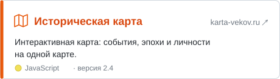

<p align="center">
  
</p>

<div align="center">
<h2>Привет, я Legendar</h2>
<p>Делаю сайты, карты и ботов</p>
<br><br>
<p>👤 Daniil • 14 y.o.<br>🎂 Birthday: April 5<br>📍 Russia</p>
<p>🔹 Сайты • интерактивные карты • Telegram-боты<br>💻 JavaScript • Python • HTML/CSS • Docker<br>🗺️ Сейчас делаю «Историческую карту» — karta-vekov.ru</p>
<br>

<br><br>

<a href="https://steamcommunity.com/profiles/76561198624055739/"></a>&#8287;&#8287;&#8287;&#8287;&#8287;&#8287;&#8287;&#8287;&#8287;&#8287;<a href="https://github.com/Legendar0504"></a>

<sub>Discord — наведи на ник и нажми 📋, чтобы скопировать</sub>

```
_legendar_
```

<a href="https://steamcommunity.com/profiles/76561198624055739/"></a>

<a href="https://github.com/Legendar0504?tab=followers"></a>

</div>

<br clear="right"/>


## 🔹 Языки и технологии

<p>
  
  
  
  
  
  
  
</p>

## 🔹 Проекты

<a href="https://karta-vekov.ru"><picture><source media="(prefers-color-scheme: dark)" srcset="assets/project-dark.svg"/></picture></a>

<details open>
<summary><h2>📊 Активность</h2></summary>

<p align="center">
  <picture><source media="(prefers-color-scheme: dark)" srcset="https://github-profile-summary-cards.vercel.app/api/cards/profile-details?username=Legendar0504&theme=github_dark&bg_color=0d1117&title_color=76A7E8&text_color=c9d1d9&border_color=30363d&icon_color=76A7E8&chart_color=76A7E8"/></picture>
</p>
<p align="center">
  <picture><source media="(prefers-color-scheme: dark)" srcset="https://github-profile-summary-cards.vercel.app/api/cards/stats?username=Legendar0504&theme=github_dark&bg_color=0d1117&title_color=76A7E8&text_color=c9d1d9&border_color=30363d&icon_color=76A7E8&chart_color=76A7E8"/></picture>&nbsp;<picture><source media="(prefers-color-scheme: dark)" srcset="https://github-profile-summary-cards.vercel.app/api/cards/productive-time?username=Legendar0504&timeZone=Europe/Moscow&theme=github_dark&bg_color=0d1117&title_color=76A7E8&text_color=c9d1d9&border_color=30363d&icon_color=76A7E8&chart_color=76A7E8"/></picture>
</p>
<p align="center">
  <picture><source media="(prefers-color-scheme: dark)" srcset="https://streak-stats.demolab.com/?user=Legendar0504&locale=ru&disable_animations=true&background=0d1117&border=30363d&stroke=30363d&ring=76A7E8&fire=76A7E8&currStreakNum=e6edf3&sideNums=e6edf3&currStreakLabel=76A7E8&sideLabels=c9d1d9&dates=8b949e"/></picture>
</p>

</details>


